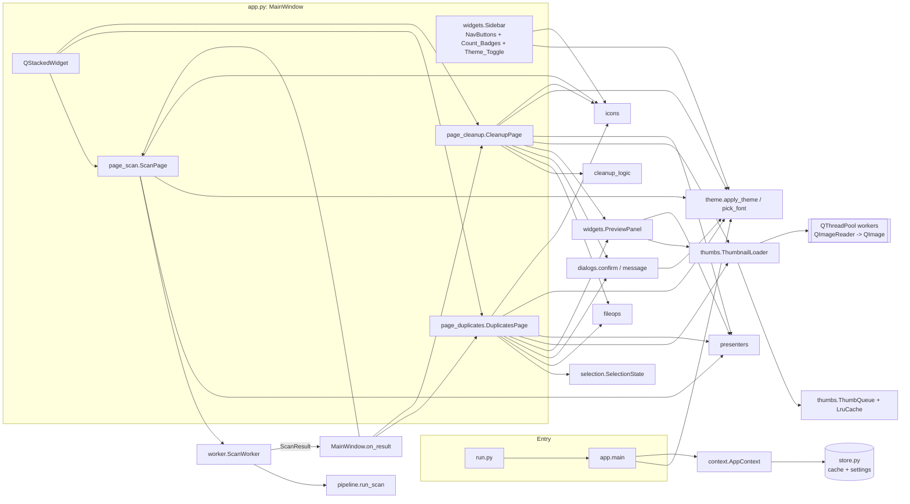
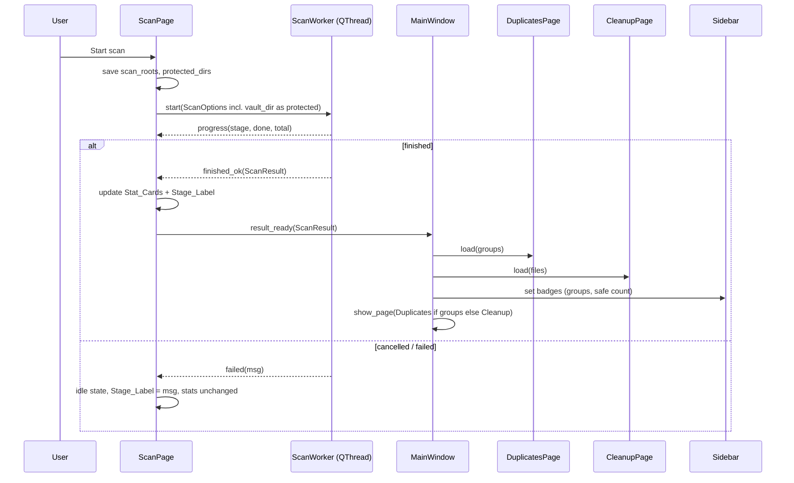
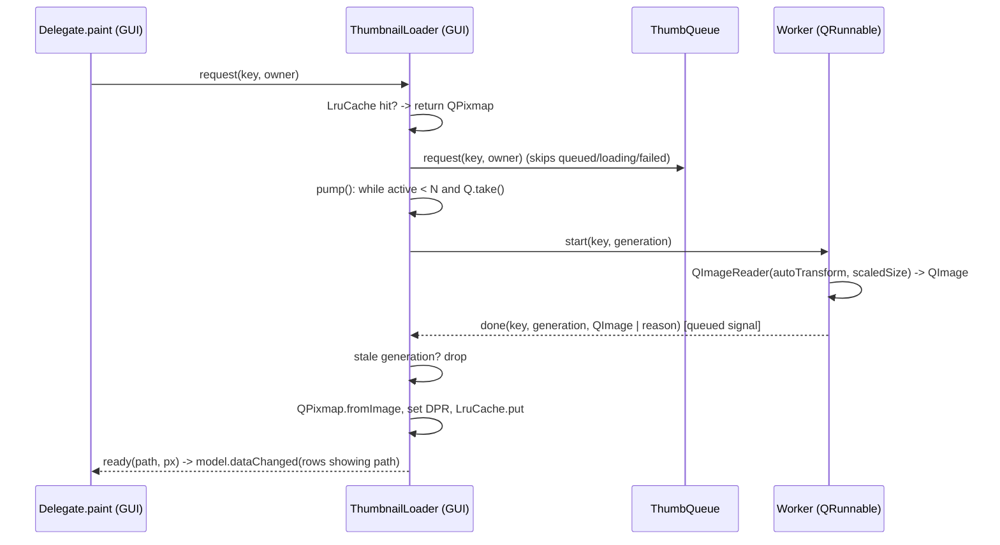

# Design Document: Modern UI Redesign

## Overview

This design covers two changes to FileSift (Python 3.12, PySide6 6.8.1 Qt Widgets, Windows):

1. **Removal of Bills & Warranty.** `bills.py`, `reminders.py` and `ui_bills.py` are deleted. The tray icon, reminder timers and the `--reminders` branch go away. `store.SCHEMA` no longer creates the `bills` and `reminders_sent` tables, but existing tables in old databases are never touched. The `vault_dir` setting survives as the Important_Folder location.
2. **Modern UI.** The `QTabWidget` + `QTableWidget`/`QTreeWidget` UI is replaced by a sidebar shell with three Pages (Scan, Duplicates, Cleanup). Everything is drawn from one Theme_Module: dark navy-slate shell, translucent panels, lavender-to-white gradient cards, cyan accent, pill buttons, line icons and large light stat numbers.

The scanner, features, duplicates, classify, pipeline and textextract modules are not changed. `ScanWorker` keeps its behaviour.

### Design principles

- **Pure logic is kept apart from Qt.** Selection rules (`selection.py`), cleanup filtering and sorting (`cleanup_logic.py`), text formatting (`presenters.py`), file operations and message builders (`fileops.py`), and thumbnail queue/cache bookkeeping (`thumbs.py`: `ThumbQueue`, `LruCache`) have no Qt imports. They are covered by Hypothesis property tests. Qt widgets only render state and forward events.
- **Model/view for scale.** Both result Pages use `QListView` with a custom `QAbstractListModel` and `QStyledItemDelegate`. Only visible items are painted, so 50,000 files or 5,000 groups cost no more widgets than 20.
- **No GUI-thread decoding.** All thumbnails and previews are decoded in worker threads as `QImage`. They become `QPixmap` on the GUI thread.
- **Tests can stub side effects.** Pages call `dialogs.confirm`, `dialogs.message` and `fileops.trash_files` through their modules, so tests can replace them, as the current smoke test does with `ui_review.confirm`.

### Research findings that shape the design

- **Thread rules.** `QPixmap` and all widgets may only be used on the GUI thread. `QImage` is reentrant and can be built in worker threads ([Qt: Threads and QObjects / reentrancy](https://doc.qt.io/qt-6/threads-reentrancy.html), [QPixmap](https://doc.qt.io/qt-6/qpixmap.html)). Workers therefore return `QImage`, and the GUI thread calls `QPixmap.fromImage`.
- **QImageReader.** `setScaledSize` lets JPEG decoders downscale while decoding, which is far cheaper than decoding full size and scaling afterwards. `setAutoTransform(True)` applies EXIF orientation on `read()`. `size()` and clip rects refer to the *untransformed* image, so for 90° rotations the target box must be swapped before calling `setScaledSize`. Qt 6 also enforces an allocation limit that rejects very large images; `setAllocationLimit(mb)` raises it ([QImageReader](https://doc.qt.io/qt-6/qimagereader.html)).
- **Qt Style Sheets** support `rgba()` colours, `qlineargradient`, `border-radius` and pseudo-states (`:hover`, `:pressed`, `:focus`, `:disabled`, `:checked`). They do not support `box-shadow` or `opacity` ([Qt Style Sheets Reference](https://doc.qt.io/qt-6/stylesheet-reference.html)). Shadows and glows must be painted or added with graphics effects. Disabled states are expressed as pre-blended colours.
- **Graphics effects.** A widget can hold only one `QGraphicsEffect`. An effect on a parent makes Qt render the whole child subtree offscreen on each repaint ([QWidget::setGraphicsEffect](https://doc.qt.io/qt-6/qwidget.html#setGraphicsEffect)). So card shadows are painted by the card itself from a cached nine-slice shadow pixmap, and `QGraphicsDropShadowEffect` is used only for the accent glow on leaf buttons.
- **Icons at high DPI.** A `QIconEngine` subclass is asked for pixmaps at device-pixel sizes, so code-drawn icons stay sharp from 100% to 200% scaling ([QIconEngine](https://doc.qt.io/qt-6/qiconengine.html)).
- **QListView performance.** `setUniformItemSizes(True)` skips per-row size queries. `LayoutMode.Batched` lays out large non-uniform models in batches so the event loop keeps running ([QListView](https://doc.qt.io/qt-6/qlistview.html)).
- **Hypothesis** is the standard Python property-based testing library. `@settings(max_examples=100)` sets the iteration count ([Hypothesis docs](https://hypothesis.readthedocs.io/en/latest/settings.html)).

## Architecture



### Module layout after the change

| Module | Status | Qt? | Role |
|---|---|---|---|
| `app.py` | rewritten | yes | `MainWindow`, `make_context`, `main`; no tray, no timers |
| `context.py` | new | no | `AppContext`, `protected_dirs_for` (moved from `ui_common`/`ui_review`) |
| `theme.py` | new | yes (apply only) | Theme_Module: palettes, sizes, QSS builder, font picking, shadow/glow helpers, contrast maths |
| `icons.py` | new | yes | Line icons drawn in code through a `QIconEngine` |
| `widgets.py` | new | yes | `Card`, `StatCard`, `PillButton`, `ToggleSwitch`, `ListRow`, `NavButton`, `Sidebar`, `Toast`, `PreviewPanel` |
| `dialogs.py` | new | yes | `ConfirmDialog`, `MessageDialog`, module functions `confirm()` and `message()` |
| `thumbs.py` | new | mixed | `LruCache`, `ThumbQueue` (pure) and `ThumbnailLoader` (Qt) |
| `selection.py` | new | no | `SelectionState` for Duplicates_Page marks and Keepers |
| `cleanup_logic.py` | new | no | Filters, sort, summary, ticks for Cleanup_Page |
| `presenters.py` | new | no | Text and number formatting: badges, stats, headers, subtitles, preview details, fit sizes |
| `fileops.py` | new | no | `trash_files`, `move_files`, `unique_target`, Important destinations, confirm/result/error texts |
| `page_scan.py` | new | yes | `ScanPage` |
| `page_duplicates.py` | new | yes | `DuplicatesPage`, `GroupModel`, `GroupDelegate` |
| `page_cleanup.py` | new | yes | `CleanupPage`, `CleanupModel`, `RowDelegate` |
| `store.py` | edited | no | SCHEMA without bill tables; `StoreOpenError`; stricter `get_list` |
| `worker.py` | unchanged | yes | `ScanWorker` |
| `ui_common.py`, `ui_review.py` | deleted | | Replaced by the modules above |
| `ui_bills.py`, `bills.py`, `reminders.py` | deleted | | Requirement 1 and 2 |
| `scanner`, `features`, `duplicates`, `classify`, `pipeline`, `textextract`, `models` | unchanged | | Requirement 14.4 |

### Scan-to-display sequence



### Thumbnail pipeline



## Components and Interfaces

### `theme.py` (Theme_Module)

All colours, radii, spacing values and font sizes live here (Requirement 6.7).

```python
@dataclass(frozen=True)
class Palette:
    name: str                 # "dark" | "light"
    bg_top: str               # shell gradient, dark: "#2A2E48"
    bg_bottom: str            # dark: "#2E3350"
    panel: str                # translucent fill "rgba(r,g,b,a)" with 0.6 <= a <= 0.9; dark: rgba(58,64,98,0.78)
    panel_border: str
    card_top: str             # lavender, dark: "#E6E3FA" (hue ~248°, L ~93%)
    card_bottom: str          # "#FFFFFF"
    text: str                 # on shell/panels, dark: "#F2F3FA"
    text_muted: str           # dark: "#A9AECB"
    card_text: str            # on lavender cards: "#1E2236"
    card_text_muted: str      # "#5A5F7D"
    accent: str               # dark: "#3DB8F5" (hue ~200°)
    on_accent: str            # text on accent fills: "#0B1226"
    accent_glow: str          # accent with alpha for glows
    input_border: str         # dark: "#8E95BD" (>= 3:1 on panel and bg)
    danger: str
    shadow: str               # "rgba(0,0,0,0.35)"

DARK: Palette
LIGHT: Palette
PALETTES = {"dark": DARK, "light": LIGHT}

# metrics
RADIUS_CARD = 22; RADIUS_CONTROL = 12; PILL_H = 36; PILL_RADIUS = PILL_H // 2
SPACING = {"xs": 4, "s": 8, "m": 12, "l": 20, "xl": 28}
SHADOW_BLUR = 24; SHADOW_DY = 6; GLOW_BLUR = 18
FONT_STAT_PT = 34; FONT_STAT_WEIGHT = 300; FONT_TITLE_PT = 18; FONT_HEADING_PT = 13
DISABLED_ALPHA = 0.5
ICON_SIZE = 20; ICON_STROKE = 1.5
FONT_FAMILIES = ("Segoe UI Variable Text", "Segoe UI")

def current() -> Palette                       # palette currently applied
def parse_color(c: str) -> tuple[int, int, int, float]
def composite(fg: str, bg: str) -> str          # alpha-blend fg over opaque bg -> "#RRGGBB"
def blend(fg: str, bg: str, alpha: float) -> str   # used for disabled colours
def relative_luminance(c: str) -> float         # WCAG 2.1
def contrast_ratio(fg: str, bg: str) -> float   # (L1 + 0.05) / (L2 + 0.05), >= 1
def hue_lightness(c: str) -> tuple[float, float]
def normalize_theme_name(value: str | None) -> str   # "dark" | "light"; anything else -> "dark"
def build_stylesheet(p: Palette) -> str         # full application QSS
def pick_font(app: QApplication, families=FONT_FAMILIES, available=None) -> str | None
def apply_theme(app: QApplication, name: str) -> Palette
def add_glow(widget: QWidget) -> None           # accent QGraphicsDropShadowEffect, offset 0, blur GLOW_BLUR
def shadow_pixmap(radius: int, blur: int, color: str, dpr: float) -> QPixmap   # cached nine-slice source
def paint_shadow(painter: QPainter, rect: QRect, radius: int) -> None
def paint_card(painter: QPainter, rect: QRect, kind: str) -> None   # "panel" | "content"
class ThemeManager(QObject):
    changed = Signal(object)                     # Palette
    def set_theme(self, name: str) -> Palette
class FocusGlowFilter(QObject)                   # app-wide event filter
```

Design decisions:

- **Stylesheet scope.** `build_stylesheet` targets widget classes plus dynamic properties: `[pill="true"]`, `[primary="true"]`, `[role="stat-value"]`, `[role="title"]`, `[role="subtitle"]`, `[card="panel"]`, `[card="content"]`, `[verdict="delete|review|keep"]`. It styles `QPushButton`, `QToolButton`, `QCheckBox`, `QComboBox` (with its popup `QAbstractItemView`), `QSlider`, `QProgressBar`, `QScrollBar`, `QListView`/`QListWidget`, `QToolTip`, `QLineEdit`, `QMenu`, `QPlainTextEdit` and `QDialog`. Each control gets `:hover`, `:pressed`, `:focus`, `:disabled` and, where relevant, `:checked` rules (Requirement 6.5, 6.8).
- **Disabled appearance.** QSS has no opacity, so `:disabled` colours are `blend(enabled_color, background, DISABLED_ALPHA)`. Hover and pressed rules are given only for `:enabled`, so disabled controls do not change on hover or press.
- **Pills.** `PillButton` fixes its height to `PILL_H`, and the QSS radius is `PILL_RADIUS` (half the height), so both ends are fully round.
- **Frosted panels.** Real Windows acrylic would need DWM calls through ctypes, so it is out of scope. Panels use `rgba` fills (alpha 0.78) over the painted shell gradient. This gives the translucent look with no platform code.
- **Shadows.** `Card.paintEvent` and the delegates call `paint_shadow`. It draws a nine-slice of one cached blurred rounded rect, blurred once with Pillow `ImageFilter.GaussianBlur` and cached per (radius, blur, colour, DPR). There are no nested graphics effects.
- **Glows.** `add_glow` is applied to each Page's primary button: Start scan, Move to Recycle Bin on Duplicates_Page, and Move to Recycle Bin on Cleanup_Page. `FocusGlowFilter`, installed on `QApplication`, adds a glow effect to any `QAbstractButton` on `FocusIn` and removes it on `FocusOut`, except on primary buttons, which keep a permanent glow.
- **Theme switching.** `ThemeManager.set_theme` calls `app.setStyleSheet(build_stylesheet(p))`. Qt re-polishes widgets in place, so input, selection and scroll positions survive. It then emits `changed`. Delegates read `theme.current()` at paint time, and pages call `viewport().update()` on `changed`. Glow effects update their colour. The shadow cache is keyed by colour.
- **Font.** `pick_font` returns the first family in `FONT_FAMILIES` present in `QFontDatabase.families()`. It builds `QFont(family)` with the current `app.font().pointSizeF()`. If neither family is installed, the Qt default font is kept and no dialog is shown (Requirement 7.1, 7.2).

### `icons.py`

```python
ICON_NAMES = ("scan", "duplicates", "cleanup", "folder", "trash", "important", "check",
              "image", "file", "sun", "moon", "close", "plus", "minus")

class LineIconEngine(QIconEngine):
    def __init__(self, name: str, role: str = "text")   # role -> palette colour key
    def paint(self, painter, rect, mode, state) -> None  # strokes path, width ICON_STROKE * scale, no fill
    def pixmap(self, size, mode, state) -> QPixmap       # renders at requested device size
    def clone(self) -> "LineIconEngine"

def icon(name: str, role: str = "text") -> QIcon        # QIcon() on any error (Requirement 7.7)
def icon_path(name: str, box: float) -> QPainterPath    # pure geometry in a box x box square
```

- Paths are built from lines, arcs and rounded rects with `QPainterPath`. They are stroked with `Qt.NoBrush`, `RoundCap` and `RoundJoin`, so no filled shapes appear (Requirement 7.4).
- The stroke colour is `palette.text` (or `on_accent` for the `on_accent` role) in `QIcon.Mode.Normal`/`Active`, and the blended disabled colour in `QIcon.Mode.Disabled`. Because the engine paints on demand, theme switches and DPR changes need no regeneration (Requirement 7.6).
- No image files ship and nothing is fetched from the network (Requirement 7.5).

### `widgets.py`

```python
class Card(QFrame):
    def __init__(self, kind: str = "panel", parent=None)   # "panel" (translucent) | "content" (lavender gradient)
    # paintEvent: paint_shadow + paint_card; contents margins leave room for the shadow

class StatCard(Card):
    def __init__(self, label: str, parent=None)
    def set_value(self, text: str) -> None                 # "—" by default
    value_label: QLabel   # role="stat-value"; weight 300, FONT_STAT_PT
    caption: QLabel

class PillButton(QPushButton):
    def __init__(self, text: str, icon_name: str | None = None, primary: bool = False,
                 checkable: bool = False, parent=None)     # fixed height PILL_H, property pill=true

class ToggleSwitch(QAbstractButton):                        # checkable, painted track + knob
    toggled_on = Signal(bool)
    def sizeHint(self) -> QSize                            # 44 x 24
    # paintEvent: track = accent when checked, input_border otherwise; knob white;
    # disabled -> blended colours; focus -> accent ring

class ListRow(QFrame):
    def __init__(self, title: str, subtitle: str = "", icon_name: str | None = None,
                 trailing: QWidget | None = None, parent=None)
    def set_subtitle(self, text: str) -> None
    def set_trailing(self, w: QWidget) -> None
    # layout: [circle icon 40px] [title / subtitle] [stretch] [trailing]

class NavButton(QToolButton):                               # checkable, icon above label, tooltip = page name
    def set_badge(self, text: str | None) -> None          # painted capsule top-right; None hides it

class Sidebar(QFrame):
    page_requested = Signal(str)                           # "scan" | "duplicates" | "cleanup"
    theme_toggled = Signal(str)                            # "dark" | "light"
    PAGES = (("scan", "Scan"), ("duplicates", "Duplicates"), ("cleanup", "Cleanup"))
    def set_active(self, page: str) -> None                # exclusive QButtonGroup -> exactly one checked
    def set_badges(self, duplicates: int | None, cleanup: int | None) -> None  # None = before first scan
    def set_theme_state(self, name: str) -> None

class Toast(QLabel):                                        # non-blocking message, auto-hides after 6 s
    def show_message(self, text: str, ms: int = 6000) -> None

class PreviewPanel(Card):
    def __init__(self, loader: "ThumbnailLoader", parent=None)
    def show_file(self, fi: FileInfo | None) -> None
    def current_path(self) -> str | None
    # children: image area (rounded content card), details = read-only QPlainTextEdit
```

`PreviewPanel` details:

- The details box is a read-only, frameless `QPlainTextEdit` with `WrapAtWordBoundaryOrAnywhere`. Long paths with no spaces still wrap, and the default context menu and Ctrl+C copy exactly the selected characters. A `QLabel` with word wrap cannot break inside a path, and inserting zero-width spaces would pollute the clipboard (Requirement 11.4).
- `show_file(fi)` immediately sets the details from `presenters.preview_details(fi)` and a placeholder image. It then requests a preview from the loader at a size bucket, which is the panel's image-area size rounded up to a multiple of 128 device pixels. On `ready(path, ...)` it updates the image only if `path == current_path()`, so the image and the details always belong to the same file (Requirement 11.6).
- When the loader reports `failed(path, reason)` with reason `"missing"` or `"unreadable"`, the panel shows the file-type placeholder plus "File missing" or "File cannot be read". The details stay, and the list is not touched (Requirement 11.7). Non-image files get the placeholder from `presenters.placeholder_label(fi)` straight away.
- `show_file(None)` shows "Select a file to preview" with no image and no details (Requirement 11.3).

### `dialogs.py`

```python
class ConfirmDialog(QDialog):
    def __init__(self, parent, title: str, message: str, confirm_label: str,
                 warning: str | None = None)
    # frameless + WA_TranslucentBackground, modal (ApplicationModal), rounded content Card,
    # header with title and a "×" close button (reject), message label, optional warning row,
    # buttons: secondary PillButton "Cancel" (default, autoDefault, initial focus), primary PillButton confirm_label

class MessageDialog(QDialog):
    def __init__(self, parent, title: str, message: str, kind: str = "info", button: str = "OK")

def confirm(parent, title: str, message: str, confirm_label: str, warning: str | None = None) -> bool
def message(parent, title: str, text: str, kind: str = "info") -> None
```

- `ConfirmDialog` returns `True` only when the confirm button's `clicked` signal fires. Enter activates the default (Cancel). Escape calls `reject()` through `QDialog`. Both the "×" button and Alt+F4 (`closeEvent`) reject (Requirement 13.2, 14.2).
- Pages never use `QMessageBox`. Every informational, warning and error message goes through `dialogs.message` (Requirement 13.8). Native `QFileDialog.getExistingDirectory` is the only unthemed window.

### `thumbs.py` (Thumbnail_Loader)

```python
Key = tuple[str, int]            # (path, size in device pixels)

class LruCache:                  # pure
    def __init__(self, capacity: int = 2000)
    def get(self, key) -> object | None      # refreshes recency on hit
    def put(self, key, value) -> list[Key]   # returns evicted keys
    def __contains__(self, key) -> bool
    def __len__(self) -> int
    def clear(self) -> None

class ThumbQueue:                # pure bookkeeping, no threads
    def __init__(self)
    def request(self, key: Key, owner: str, cached: bool) -> bool   # False if cached, queued, loading or failed path
    def cancel(self, key: Key) -> bool                              # removes a queued (not loading) request
    def retain(self, owner: str, keys: set[Key]) -> list[Key]       # drop owner's queued keys not in `keys`
    def take(self) -> Key | None                                    # newest queued -> loading (LIFO)
    def finish(self, key: Key, ok: bool) -> None                    # loading -> done; ok=False adds path to failed
    def is_failed(self, path: str) -> bool
    def reset(self) -> None                                         # clear queued + failed, bump generation
    generation: int
    queued: list[Key]; loading: set[Key]

class ThumbnailLoader(QObject):
    ready = Signal(str, int)                 # path, size
    failed = Signal(str, int, str)           # path, size, reason: "missing" | "unreadable" | "unsupported"
    def __init__(self, workers: int = 3, capacity: int = 2000, parent=None)
    def get(self, path: str, size: int) -> QPixmap | None          # cache lookup only
    def request(self, path: str, size: int, owner: str) -> QPixmap | None   # cache hit or enqueue
    def retain(self, owner: str, keys: set[Key]) -> None
    def is_failed(self, path: str) -> bool
    def reset(self) -> None                  # called when a new Scan_Result is loaded
    def shutdown(self, timeout_ms: int = 2000) -> None

def decode_thumbnail(path: str, size: int) -> tuple[QImage | None, str]   # worker-side, no QPixmap
```

- **Worker pool.** `QThreadPool` holds `workers` threads. `ThumbnailLoader` keeps its own `ThumbQueue` and starts a `QRunnable` only when a slot is free (`_pump`). Cancelling is then a pure queue operation and does not depend on `QThreadPool.tryTake`. The queue is LIFO, so the rows the user just scrolled to load first.
- **Decoding.** `decode_thumbnail` checks `os.path.exists`, which gives the "missing" reason. It creates `QImageReader(path)` with `setAutoTransform(True)` and reads `size()`. If `transformation()` includes `TransformationRotate90`, the box is swapped. It computes `presenters.fit_size(w, h, size, size)`, which never enlarges, calls `setScaledSize` and then `read()`. A null image gives "unreadable", and a format with no Qt reader gives "unsupported". At startup `main` calls `QImageReader.setAllocationLimit(1024)` so large camera images are not rejected.
- **Delivery.** The runnable emits through a `_Bridge(QObject)` that lives on the GUI thread, which makes the connection queued. The GUI handler drops results whose generation is not current, converts to `QPixmap`, sets the device pixel ratio, stores the pixmap in `LruCache`, and emits `ready` or `failed`.
- **Visibility.** Delegates call `request` from `paint`, and Qt paints only items inside the viewport (Requirement 12.2). Each page connects its scrollbar's `valueChanged` and its resize events to a 50 ms single-shot timer. The timer collects the keys of visible indexes (walking `indexAt` from the top of the viewport to the bottom) and calls `retain(owner, keys)`, which removes queued requests that have scrolled away (Requirement 12.4).
- **Display.** Pages map `ready(path, size)` to model rows through a `path -> row` dict and emit `dataChanged` for those rows only. Delegates always paint from the model's current file, so a pixmap can never appear on a row that now shows another file (Requirement 12.11).

### `selection.py`

```python
class ToggleResult(Enum):
    MARKED = "marked"; UNMARKED = "unmarked"
    REFUSED_LAST = "refused_last"; REFUSED_PROTECTED = "refused_protected"

LAST_COPY_MSG = "Cannot select every copy in a group: at least one must be kept."

class SelectionState:
    def __init__(self, groups: list[DupGroup])            # groups ordered by wasted desc (stable)
    def group_ids(self) -> list[int]                      # live groups in display order
    def group(self, gid: int) -> DupGroup
    def group_of(self, path: str) -> int
    def is_marked(self, path: str) -> bool
    def is_keeper(self, path: str) -> bool
    def toggle(self, path: str) -> ToggleResult
    def auto_select(self, rule: str) -> None
    def clear(self) -> None
    def marked_files(self) -> list[FileInfo]              # display order
    def marked_size(self) -> int
    def remove_files(self, paths: set[str]) -> list[int]  # returns removed group ids (< 2 files left)
    def total_reclaimable(self) -> int                    # sum of wasted over live groups
```

Rules:

- `toggle` on a Protected_File returns `REFUSED_PROTECTED`. Marking is refused with `REFUSED_LAST` when every other file in the group is already marked. Protected files never count as marked. Marking a Keeper removes its Keep badge.
- `auto_select` sets `keeper = duplicates.pick_keeper(group, rule)` for each group. That function already prefers Protected_Files. It then marks every non-protected non-keeper, replaces any earlier marks, and resets the keeper set.
- `clear` empties both the marks and the keepers.
- `remove_files` deletes the given files from their groups, along with their marks and keeper flags, and drops groups left with fewer than two files. Only marked files are ever passed in, so every surviving group keeps its unmarked file.

### `cleanup_logic.py`

```python
VERDICT_FILTERS = ("All", "Safe to delete", "Review", "Keep", "Important")
BUCKET_FOR = {"Safe to delete": "delete", "Review": "review", "Keep": "keep"}
VERDICT_LABEL = {"delete": "Safe to delete", "review": "Review", "keep": "Keep"}
SORTS = ("Score", "Oldest first", "Largest first")
MAX_ROWS = 20000

def matches(f: FileInfo, verdict: str, category: str | None) -> bool
def categories(files: list[FileInfo]) -> list[str]                        # distinct, alphabetical
def sort_key(sort: str) -> Callable[[FileInfo], tuple]
#   "Score":         (-score, best_date, path)
#   "Oldest first":  (best_date, path)
#   "Largest first": (-size, path)
def filter_and_sort(files, verdict, category, sort) -> list[FileInfo]     # all matches, sorted
def visible_rows(matches: list[FileInfo], limit: int = MAX_ROWS) -> list[FileInfo]   # matches[:limit]
def match_status(total: int, limit: int = MAX_ROWS) -> str
#   "<total> files match." or "<total> files match (showing first 20000)."

@dataclass
class CleanupSummary:
    total: int; delete: int; review: int; keep: int; delete_size: int; important: int
def summarize(files) -> CleanupSummary
def summary_text(s: CleanupSummary) -> str      # ends with "Nothing is deleted until you confirm."
def without_paths(files: list[FileInfo], paths: set[str]) -> list[FileInfo]   # order-preserving removal

class TickSet:
    def toggle(self, f: FileInfo) -> bool       # protected -> stays unticked, returns False
    def tick_all_safe(self, visible: list[FileInfo]) -> None
    def clear(self) -> None
    def is_ticked(self, path: str) -> bool
    def actionable(self, visible: list[FileInfo]) -> list[FileInfo]   # ticked, non-protected, in display order
    def discard(self, paths: set[str]) -> None
```

### `presenters.py`

```python
EM_DASH = "—"
def format_badge(n: int) -> str | None          # 0 -> None, 1..999 -> str(n), >999 -> "999+"
@dataclass(frozen=True)
class ScanStats: files: int; total_size: int; groups: int; reclaimable: int; safe: int
def scan_stats(result: ScanResult) -> ScanStats
def stat_texts(stats: ScanStats | None) -> list[str]   # five strings; all "—" when None
def stage_text(stage: str, done: int, total: int) -> str   # counts omitted when total == 0
def done_text(stats: ScanStats) -> str
def group_header(number: int, g: DupGroup) -> str      # "Group 3 · exact · 4 files · 12.4 MB reclaimable"
def duplicates_summary(n_groups: int, reclaimable: int) -> str
def marked_text(count: int, size: int) -> str         # "2 marked · 4.1 MB"
def tile_lines(f: FileInfo) -> list[str]              # name, size, "W x H" (images only), date
def row_subtitle(f: FileInfo, now: float) -> str      # category · reasons|tags · N days · size
def preview_details(f: FileInfo) -> list[str]          # path, res?, size, date, category, tags?, reasons?
def placeholder_label(f: FileInfo) -> str             # extension without dot, upper-case, or "file"
def fit_size(w: int, h: int, box_w: int, box_h: int) -> tuple[int, int]   # keep aspect, never enlarge
def tiles_per_row(width: int, tile_w: int, gap: int, pad: int) -> int     # >= 1
def group_card_height(n_files: int, per_row: int, m: "GroupMetrics") -> int
def tile_rects(card: Rect, n_files: int, per_row: int, m: "GroupMetrics") -> list[Rect]
def badge_rect(tile: Rect, m) -> Rect; def check_rect(tile: Rect, m) -> Rect
def hit_test(tiles: list[Rect], px: int, py: int, m) -> tuple[str, int] | None   # ("toggle"|"preview", k)
def index_by_path(rows: list[FileInfo]) -> dict[str, list[int]]   # used by both models' rows_for_path
def add_unique(items: list[str], path: str) -> list[str]           # Scan_Page "Add folder"
def remove_selected(items: list[str], selected: set[int]) -> list[str]   # Scan_Page "Remove"
```

`Rect` is a small pure `NamedTuple(x, y, w, h)` with `contains(px, py)`, so tile layout and hit-testing can be property-tested without Qt.

### `fileops.py`

```python
def trash_files(paths: list[str]) -> tuple[list[str], list[str]]          # (done, "path: reason" errors)
def unique_target(dest_dir: Path, name: str,
                  exists: Callable[[Path], bool] = Path.exists) -> Path
def important_subfolder(f: FileInfo) -> str            # f.tags[0] if tags else category[:1].upper() + category[1:]
def important_destination(f: FileInfo, base: Path) -> Path      # base / important_subfolder(f)
def move_files(paths: list[str], dest_dir: Path) -> tuple[list[tuple[str, str]], list[str]]
def move_to_important(files: list[FileInfo], base: Path) -> tuple[list[tuple[str, str]], list[str]]
def recycle_confirm(files: list[FileInfo]) -> tuple[str, str, str | None]   # title, message, warning
def move_confirm(files: list[FileInfo], base: Path) -> tuple[str, str]
def format_errors(errors: list[str], limit: int = 15) -> str
def result_text(op: str, moved: int, freed: int | None, failed: int) -> str
```

- `move_files` keeps the current behaviour: `mkdir(parents=True, exist_ok=True)`, a `unique_target` name, then `shutil.move`. Failures are collected and processing continues.
- `move_to_important` groups files by `important_destination` and moves each group straight into `base/<sub>`. The base is `settings.vault_dir` itself, with no extra `Important` level (Requirement 4.5). This changes the old `vault_dir/"Important"` base.
- `recycle_confirm` message: `"Move {n} files ({size}) to the Recycle Bin?\nYou can restore them from the Recycle Bin."`. The warning, when present, is `"Warning: {k} of these files are marked Keep or Important."`.
- `move_confirm` message: `"Move {n} files into\n{base}\\<tag or category>?"` with the full absolute base path.
- `format_errors` returns the first 15 errors one per line, plus `"…and {k} more errors not shown."` when `k > 0`.

### `context.py`

```python
@dataclass
class AppContext:
    con: sqlite3.Connection
    settings: Settings
    cache: Cache
    theme: ThemeManager | None = None

def protected_dirs_for(ctx: AppContext) -> list[str]   # [vault_dir] + protected_dirs setting
```

### Pages

#### `page_scan.ScanPage`

```python
class ScanPage(QWidget):
    result_ready = Signal(object)            # ScanResult
    def __init__(self, ctx: AppContext, parent=None)
    def start_scan(self) -> None
    def is_running(self) -> bool
    def shutdown(self, timeout_ms: int = 3000) -> bool   # cancel + wait; False if still running
    roots: QListWidget; prot: QListWidget
    similar: ToggleSwitch; strict: QSlider; text: ToggleSwitch
    vault_row: ListRow; stats: list[StatCard]; bar: QProgressBar; stage: QLabel
    start: PillButton; cancel: PillButton
```

- Layout: a `QScrollArea` (transparent, `widgetResizable`) holds everything, so every control stays reachable at 1000 x 650 (Requirement 5.7). From top to bottom:
  - a row of five `StatCard`s with captions "Files scanned", "Total size", "Duplicate groups", "Reclaimable", "Safe to delete";
  - two folder `Card`s side by side, each with a `QListWidget` (extended selection) and "Add folder" / "Remove" pills;
  - an options `Card` with three `ListRow`s (similar images + `ToggleSwitch`; strictness + `QSlider` 2..12, default 6, value label "distance 6 (recommended)"; OCR/PDF + `ToggleSwitch` whose subtitle states Tesseract/PyMuPDF availability);
  - an Important folder `ListRow` (title "Important folder", subtitle = absolute `vault_dir`, "Change..." pill);
  - the run row: progress bar, Start scan (primary, glow) and Cancel.
- `_add` uses `QFileDialog.getExistingDirectory`. It normalizes the path with `os.path.normpath` and rebuilds the list from `presenters.add_unique`. `_remove` rebuilds it from `presenters.remove_selected`. "Change..." saves `vault_dir` only when a folder is chosen.
- `start_scan` keeps the current logic. It shows a Message_Dialog and returns before saving anything when the root list is empty. Otherwise it saves `scan_roots` and `protected_dirs` in display order, then builds `ScanOptions` with `protected_dirs_for(ctx)` (Requirement 4.4, 8.13, 8.14).
- Progress: `stage_text`, and `bar.setRange(0, 0)` when total is 0 (indeterminate). On done, the page updates the stats with `stat_texts(scan_stats(result))` and emits `result_ready`. On failure or cancel it resets to idle, puts the message in the Stage_Label and leaves the stats alone.

#### `page_duplicates.DuplicatesPage`

```python
class GroupModel(QAbstractListModel):        # one row per live group
    GroupRole, NumberRole
    def __init__(self, state: SelectionState)
    def reset_state(self, state: SelectionState) -> None
    def remove_groups(self, gids: list[int]) -> None    # beginRemoveRows per contiguous block
    def rows_for_path(self, path: str) -> list[int]
    def refresh_all(self) -> None                       # dataChanged over all rows (after auto/clear)

class GroupDelegate(QStyledItemDelegate):
    tile_clicked = Signal(str)               # preview
    tile_toggled = Signal(str)               # selection control hit
    def __init__(self, view: QListView, loader: ThumbnailLoader)
    def sizeHint(self, option, index) -> QSize          # uses view.viewport().width() + presenters
    def paint(self, painter, option, index) -> None     # shadow, content card, header, tiles
    def editorEvent(self, event, model, option, index) -> bool   # hit-test via presenters.tile_rects

class DuplicatesPage(QWidget):
    changed = Signal()                       # files removed -> badge refresh
    def __init__(self, ctx: AppContext, loader: ThumbnailLoader, parent=None)
    def load(self, groups: list[DupGroup]) -> None
    def auto_select(self) -> None
    def clear_selection(self) -> None
    def checked_files(self) -> list[FileInfo]          # kept name for the smoke test
    def toggle(self, path: str) -> ToggleResult         # same path as a tile click
    def delete_selected(self) -> None
    def group_count(self) -> int
    view: QListView; model: GroupModel; state: SelectionState; preview: PreviewPanel
    rule: QComboBox; summary: QLabel; marked_label: QLabel; status: QLabel; empty: QLabel
```

- **View.** `QListView` in `ListMode`, `ScrollPerPixel`, `ResizeMode.Adjust`, `LayoutMode.Batched` (batch 100), with selection disabled. Selection lives in `SelectionState`, and the preview target is tracked separately. A resize debounce timer calls `view.doItemsLayout()` so card heights follow the tiles-per-row count.
- **Group_Card painting.** The delegate paints the shadow, the lavender gradient card, the header (`group_header`), then each tile:
  - the thumbnail from `loader.request(path, TILE_PX * dpr, owner="dups")`, or a same-size placeholder while loading (Requirement 12.3), or the `image`/`file` fallback icon when failed;
  - the tile text from `tile_lines`, with the folder in a tooltip handled by `helpEvent`;
  - a round check control (absent for protected files) and badges: "Protected", or "Keep" when `state.is_keeper`;
  - an accent outline when the file is marked, and a thin accent ring on the current preview tile.
- **Hit-testing.** In `editorEvent`, a `MouseButtonRelease` inside `check_rect` emits `tile_toggled`, and one inside the tile emits `tile_clicked` (Requirement 9.4, 9.5).
- **Toggle handling.** `toggle(path)` calls `state.toggle`. `REFUSED_LAST` writes `LAST_COPY_MSG` to the Status_Area. The page then updates the row and the marked label (`marked_text`, synchronously, well under 200 ms).
- **delete_selected.** With nothing marked it shows `dialogs.message(..., "Nothing selected.")`. Otherwise it calls `dialogs.confirm(*recycle_confirm(files)[:2], "Move to Recycle Bin")` and, if confirmed, `fileops.trash_files`. Next come `cache.forget(done)`, `state.remove_files(set(done))` and `model.remove_groups(...)`, and then the summary, marked label and status (`result_text`) are refreshed. `format_errors` goes to an error Message_Dialog when anything failed. Failed files stay marked (Requirement 9.11–9.13, 9.16, 9.17).
- **Empty state.** A centred `QLabel` "No duplicates found." sits over the view when `group_count() == 0`, with the summary "0 duplicate groups · 0 B reclaimable" (Requirement 9.18).
- **Layout.** A `QSplitter` holds [view | PreviewPanel]. A toolbar row above it holds the Keep-rule combo, the "Auto-select" and "Clear selection" pills, a stretch, the marked label and the primary "Move to Recycle Bin" pill.

#### `page_cleanup.CleanupPage`

```python
class CleanupModel(QAbstractListModel):
    FileRole, TickRole
    def set_rows(self, rows: list[FileInfo]) -> None    # beginResetModel / endResetModel
    def rows_for_path(self, path: str) -> list[int]
    def file_at(self, row: int) -> FileInfo | None

class RowDelegate(QStyledItemDelegate):
    tick_toggled = Signal(int)               # row
    def sizeHint(...) -> QSize               # fixed 68 px (uniform sizes)
    def paint(...)                           # panel row, circle thumb (40 px), title, subtitle, verdict pill, tick or "Protected"
    def editorEvent(...) -> bool             # click in tick rect -> tick_toggled

class CleanupPage(QWidget):
    changed = Signal()
    def __init__(self, ctx: AppContext, loader: ThumbnailLoader, parent=None)
    def load(self, files: list[FileInfo]) -> None
    def refresh(self) -> None
    def set_verdict(self, name: str) -> None
    def tick_safe(self) -> None
    def clear_ticks(self) -> None
    def trash_ticked(self) -> None
    def move_important(self) -> None
    def row_count(self) -> int
    view: QListView; model: CleanupModel; ticks: TickSet; preview: PreviewPanel
    verdict_buttons: dict[str, PillButton]; category: QComboBox; sort: QComboBox
    summary: QLabel; status: QLabel
```

- The verdict filter is five checkable `PillButton`s in an exclusive `QButtonGroup`, with "All" checked. The category `QComboBox` holds "All categories" followed by `categories(files)`, and the sort `QComboBox` holds `SORTS`. Any change calls `ticks.clear()` and then `refresh()` (Requirement 10.2, 10.3).
- `refresh()` runs `filter_and_sort` and then `visible_rows`, calls `model.set_rows`, and writes `match_status(len(matches))` to the status. Python sorting of 50,000 `FileInfo` keys takes tens of milliseconds, inside the 100 ms budget.
- The `QListView` uses `setUniformItemSizes(True)` and single selection. `currentChanged` calls `preview.show_file`.
- `trash_ticked()` and `move_important()` read `ticks.actionable(rows)`. An empty list shows the Message_Dialog "Nothing ticked." Otherwise they confirm through `dialogs.confirm` with the warning from `recycle_confirm`, run `fileops.trash_files` or `fileops.move_to_important(files, ctx.settings.vault_dir)`, then call `_forget(succeeded)`. `_forget` sets `self.files = without_paths(self.files, succeeded)` and removes the files from the ticks and the cache. It then recomputes the summary and the category list, refreshes, and emits `changed`. Errors are shown in the error Message_Dialog.
- With no Scan_Result loaded, the summary reads "Run a scan first." and the list is empty (Requirement 10.15).

### `app.MainWindow` and `main`

```python
class MainWindow(QMainWindow):
    def __init__(self, ctx: AppContext)
    def show_page(self, name: str) -> None     # stack index + sidebar.set_active(name): single source of truth
    def current_page(self) -> str
    def on_result(self, result: ScanResult) -> None
    def update_badges(self) -> None
    def closeEvent(self, e) -> None            # scan.shutdown(3000); loader.shutdown(2000)
    scan: ScanPage; dups: DuplicatesPage; cleanup: CleanupPage; sidebar: Sidebar
    loader: ThumbnailLoader; toast: Toast

def make_context() -> AppContext
def main(argv: list[str] | None = None) -> int
```

- **Window setup.** The window opens at `resize(1250, 800)` with `setMinimumSize(1000, 650)`. The central widget is a `Shell` that paints the background gradient and holds [Sidebar | QStackedWidget]. No `QSystemTrayIcon` and no `QTimer` for reminders are created (Requirement 1.3, 1.4).
- **Results.** `on_result` calls `loader.reset()`, `dups.load(groups)`, `cleanup.load(files)` and `update_badges()`, then `show_page("duplicates" if groups else "cleanup")`. Badges are `None` until the first `on_result`, after which they show `format_badge(dups.group_count())` and `format_badge(safe_count)`. Pages emit `changed` after file operations and `update_badges()` runs synchronously. Cancelled or failed scans never call `on_result`, so the badges and the active Page stay the same (Requirement 5.10).
- **Theme toggle.** The Sidebar's `theme_toggled(name)` calls `ctx.theme.set_theme(name)` and then `settings.set("theme", name)` inside `try/except sqlite3.Error`. On failure it calls `toast.show_message("Theme choice could not be saved and will not persist after restart.")` (Requirement 15.3, 15.7).
- **`main(argv)`.** The steps run in this order:
  1. `QApplication(argv)` and `setStyle("Fusion")`.
  2. `QImageReader.setAllocationLimit(1024)`.
  3. `pick_font(app)`.
  4. `make_context()` inside `try`. On `StoreOpenError` it applies the dark theme, shows a Message_Dialog naming the database path, and returns 1.
  5. It reads `theme` through `normalize_theme_name`. `sqlite3.Error` falls back to "dark".
  6. `apply_theme`.
  7. `MainWindow`, `show()`, then `code = app.exec()`.
  8. If `win.clean_shutdown` is False (a scan thread did not stop within 3 s), it calls `os._exit(code)`, because non-daemon `ThreadPoolExecutor` threads inside the pipeline would otherwise delay exit (Requirement 1.7).

  `argv` is never checked for `--reminders`, so that flag starts the normal window (Requirement 2.3).
- **`run.py`.** The docstring becomes `"""Launch FileSift:  python run.py"""`, and the file still calls `sys.exit(main())`.

### `store.py` changes

- `SCHEMA` keeps only `CREATE TABLE IF NOT EXISTS cache (...)` and `CREATE TABLE IF NOT EXISTS settings (...)`, with identical column definitions. Existing `bills`/`reminders_sent` tables are never referenced, dropped or altered (Requirement 3.1, 3.2, 3.4).
- `connect()` wraps `sqlite3.connect` and `executescript` in `try/except sqlite3.DatabaseError` (which includes `OperationalError` "database is locked" and "file is not a database"). It closes the connection and raises `StoreOpenError(path, reason)`. It never removes, renames or recreates the file (Requirement 3.6). The module docstring becomes "SQLite storage: feature cache and settings."
- `Settings.get_list()` returns the parsed value only when it is a `list` whose items are all `str`. Otherwise it returns `[]`. Reads never write (Requirement 3.5). This fixes a latent bug where a stored JSON string such as `"abc"` became `['a', 'b', 'c']`.
- `Settings.vault_dir` keeps the `DEFAULT_VAULT = ~/Documents/FileSift Vault` default (Requirement 4.3).

### Other text changes (Requirement 2.4)

- `filesift/__init__.py`: `"""FileSift: local duplicate finder and junk/screenshot cleaner."""`.
- `app.py` docstring: `"""Main window and entry point."""`.
- `requirements.txt` comments: "Optional: text extraction from PDFs (important-file detection)" and "Optional: OCR for screenshots -> install Tesseract OCR for Windows (and the "hin" language data for Hindi)".
- New `requirements-dev.txt`: `-r requirements.txt`, `pytest`, `hypothesis`. These are test-only and not runtime dependencies (Requirement 16.2).

## Data Models

Existing models are unchanged: `FileInfo`, `DupGroup` (`wasted` = Reclaimable_Size), `ScanOptions` and `ScanResult`.

### New pure data types

```python
# selection.py
@dataclass
class _GroupSel:
    group: DupGroup
    marked: set[str]          # paths, never contains a protected path
    keeper: str | None        # path chosen by the last auto_select (cleared by mark/clear)

class SelectionState:
    _groups: dict[int, _GroupSel]   # gid -> state, insertion order = display order
    _group_of: dict[str, int]       # path -> gid
```

Invariants held by `SelectionState`:

- I1: for every live group, `marked ⊆ {non-protected paths}`.
- I2: `|marked| < |files|`, so at least one file is unmarked or protected.
- I3: `keeper` is either `None` or a path that is not in `marked`.
- I4: every live group has at least 2 files.

```python
# cleanup_logic.py
@dataclass
class CleanupSummary: total: int; delete: int; review: int; keep: int; delete_size: int; important: int

class TickSet:
    _ticked: set[str]         # never contains a protected path

# thumbs.py
Key = tuple[str, int]
class ThumbQueue:
    queued: list[Key]         # unique keys, newest last
    owners: dict[Key, str]
    loading: set[Key]
    failed: set[str]          # paths, cleared by reset()
    generation: int

class LruCache:
    _d: OrderedDict[Key, object]   # len <= capacity; most recently used last

# presenters.py
class Rect(NamedTuple): x: int; y: int; w: int; h: int
@dataclass(frozen=True)
class GroupMetrics: pad: int = 20; header_h: int = 44; tile_w: int = 160; tile_h: int = 212
                     gap: int = 12; thumb: int = 140; check: int = 24; margin: int = 10
@dataclass(frozen=True)
class ScanStats: files: int; total_size: int; groups: int; reclaimable: int; safe: int

# theme.py
@dataclass(frozen=True)
class Palette: ...            # see Components
```

### Qt model roles

| Model | Role | Value |
|---|---|---|
| `GroupModel` | `GroupRole` (`UserRole + 1`) | gid (`int`); the delegate reads the group from `SelectionState` |
| `GroupModel` | `NumberRole` (`UserRole + 2`) | 1-based display number |
| `CleanupModel` | `FileRole` (`UserRole + 1`) | `FileInfo` |
| `CleanupModel` | `TickRole` (`UserRole + 2`) | `bool` from `TickSet` |
| both | `DisplayRole` | file or group title (accessibility, tooltips) |

### Settings keys (table `settings`)

| Key | Type | Default | Notes |
|---|---|---|---|
| `scan_roots` | JSON list[str] | `[~/Pictures, ~/Downloads]` (existing ones only) | Saved on scan start |
| `protected_dirs` | JSON list[str] | `[]` | Saved on scan start |
| `vault_dir` | str path | `~/Documents/FileSift Vault` | Important_Folder |
| `theme` | `"dark"` \| `"light"` | `"dark"` | Invalid values are read as `"dark"`, and the stored value is not rewritten |

### Database tables

`cache(path TEXT PRIMARY KEY, size INTEGER, mtime REAL, feat TEXT, sha TEXT, text TEXT)` and `settings(key TEXT PRIMARY KEY, value TEXT)` are unchanged. In databases from 1.0.0, `bills` and `reminders_sent` stay exactly as they are and are never read.

## Correctness Properties

*A property is a characteristic or behavior that should hold true across all valid executions of a system-essentially, a formal statement about what the system should do. Properties serve as the bridge between human-readable specifications and machine-verifiable correctness guarantees.*

Notes from the reflection step: several overlapping criteria were merged into single properties:

- 3.1, 3.2 and 3.4 become one store-open property.
- 3.3 and 8.14 become one settings round-trip property.
- 9.7, 9.14, 14.3 (duplicates part) and 14.5 become one action-sequence invariant.
- 9.8 and 9.15 become one auto-select property.
- 10.3 and 10.5 become one filter-and-sort property.
- 10.10, 13.3, 13.6 and 13.7 become one confirm-text property.
- 10.16, 12.8 and 12.9 become one row-cap property.
- 12.2, 12.4 and 12.10 become one model-based queue property.
- 9.12 and 13.5 share the result-text property.
- 4.7, 14.6 and 10.12 share the move-partition and removal properties.

Criteria that are fixed constants, layout, timing, or process-level are covered by example, smoke or integration tests in the Testing Strategy.

### Property 1: Opening the store creates only cache and settings and preserves every existing table

*For any* SQLite database file containing any subset of the tables {`cache`, `settings`, `bills`, `reminders_sent`} with any rows, and *for any* sequence of `Cache.put` / `Cache.forget` / `Settings.set` calls made after opening it with `store.connect`, the set of tables after opening equals the original set ∪ {`cache`, `settings`}. `bills` and `reminders_sent` exist afterwards only if they existed before, and their column definitions, row count and row values are identical before and after the open and the writes. Rows that existed in `cache` and `settings` are identical immediately after the open.

**Validates: Requirements 3.1, 3.2, 3.4, 1.6, 2.7**

### Property 2: Settings and cache round-trip across a 1.0.0 database

*For any* list of folder-path strings for `scan_roots` and `protected_dirs`, any `vault_dir` path, and any set of cache rows (path, size, mtime, feat, sha, text), written into a database using the FileSift 1.0.0 schema (including the legacy bill tables) and then reopened with the new `store.connect`, `Settings.get_list` returns each list with the same items in the same order, `Settings.vault_dir` returns the stored path, and `Cache.get(path, size, mtime)` returns each stored row whose size and mtime match. The same holds for `set_list` followed by `get_list` on a fresh store.

**Validates: Requirements 3.3, 8.14, 4.2**

### Property 3: Invalid list settings read as empty without being rewritten

*For any* stored string value for a list key, `Settings.get_list` returns the decoded list when the value is a JSON array of strings, and `[]` otherwise (invalid JSON, JSON non-array, array containing non-strings, missing key). It raises no error, and the stored value is byte-for-byte unchanged after the call. A missing `vault_dir` returns `DEFAULT_VAULT`.

**Validates: Requirements 3.5, 4.3**

### Property 4: Non-SQLite files are never modified by a failed open

*For any* non-empty byte string that does not start with the SQLite header `"SQLite format 3\0"`, written to a file and passed to `store.connect`, the call raises `StoreOpenError`, and the file exists afterwards with exactly the same bytes.

**Validates: Requirements 3.6**

### Property 5: Important destination is one level below the Important folder

*For any* `FileInfo` with any list of Important_Tags and any Category, and *for any* base folder path, `important_destination(f, base).parent == base`. Its name equals `f.tags[0]` when `f.tags` is non-empty, and `f.category[:1].upper() + f.category[1:]` otherwise.

**Validates: Requirements 4.5**

### Property 6: Collision-free target names use the lowest free suffix

*For any* destination folder, file name `stem + ext`, and set of names already present, `unique_target` returns `name` if it is not present. Otherwise it returns `f"{stem} ({n}){ext}"` where `n` is the smallest integer ≥ 2 whose name is not present. The returned name is never in the present set.

**Validates: Requirements 4.6, 14.7**

### Property 7: File moves partition into moved and failed without touching failures

*For any* list of source files where each file either exists or does not (in a temporary directory), and *for any* pre-existing files in the destination, `move_files` returns `moved` containing exactly the sources that existed and `errors` containing exactly one entry naming each missing source. Every moved file exists at its returned target with its original bytes, and every file that was already in the destination keeps its bytes.

**Validates: Requirements 4.7, 14.6**

### Property 8: Count_Badge formatting

*For any* integer `n ≥ 0`, `format_badge(n)` is `None` when `n == 0`, `str(n)` when `1 ≤ n ≤ 999`, and `"999+"` when `n > 999`.

**Validates: Requirements 5.6**

### Property 9: Exactly one Sidebar button matches the active Page

*For any* sequence of navigation actions on one `MainWindow` (Sidebar clicks on any Page, `on_result` with zero or more Duplicate_Groups, and cancelled scans), after every action exactly one Sidebar Page button is checked, and it is the button whose Page is the current widget of the stack. After `on_result`, the current Page is Duplicates_Page if the result has groups and Cleanup_Page otherwise.

**Validates: Requirements 5.3, 5.4, 5.5, 5.9**

### Property 10: Font family selection

*For any* set of installed font family names, `pick_font` returns the first entry of `("Segoe UI Variable Text", "Segoe UI")` that is in the set, or `None` (keep the Qt default) when neither is present, and never raises.

**Validates: Requirements 7.1, 7.2**

### Property 11: Folder list editing

*For any* list of distinct folder paths, any path `p`, and any set of selected indexes `S`, `add_unique(list, p)` equals `list` when `p` is already in `list` and `list + [p]` otherwise. `remove_selected(list, S)` equals `[x for i, x in enumerate(list) if i not in S]`, which is unchanged when `S` is empty.

**Validates: Requirements 8.2, 8.3**

### Property 12: Scan statistics

*For any* `ScanResult`, `scan_stats` returns `files == len(files)`, `total_size == sum(f.size)`, `groups == len(groups)`, `reclaimable == sum(g.wasted for g in groups)` and `safe == count(f.bucket == "delete")`. `stat_texts(stats)` renders the counts as whole numbers and the sizes as `human_size` values. `stat_texts(None)` is five `"—"` strings.

**Validates: Requirements 8.7, 8.8**

### Property 13: Stage text shows counts only for known totals

*For any* stage name and integers `done ≥ 0`, `total ≥ 0`, `stage_text(stage, done, total)` starts with the stage name. It contains `f"{done}/{total}"` when `total > 0`, and contains no digits beyond those in the stage name when `total == 0`.

**Validates: Requirements 8.10**

### Property 14: Duplicate selection invariant under any action sequence

*For any* list of Duplicate_Groups with any mix of protected and non-protected files, and *for any* sequence of `toggle(path)`, `auto_select(rule)`, `clear()` and `remove_files(subset of marked paths)` actions, after every action each live group has at least two files, at least one file in each live group is unmarked or protected, and no Protected_File is marked.

**Validates: Requirements 9.6, 9.7, 9.14, 14.3, 14.5**

### Property 15: Toggle semantics

*For any* selection state and any non-protected file `p`: if `p` is marked, `toggle(p)` unmarks it. If `p` is unmarked and every other file in its group is marked, `toggle(p)` returns `REFUSED_LAST` and changes nothing. Otherwise `toggle(p)` marks it. Toggling a marked file twice restores the original marked set. `toggle` on a Protected_File returns `REFUSED_PROTECTED` and changes nothing.

**Validates: Requirements 9.5, 9.6**

### Property 16: Auto-select picks one keeper and marks the rest

*For any* list of Duplicate_Groups, any prior marked state and any rule in `KEEPER_RULES`, after `auto_select(rule)` each live group has exactly one Keeper, equal to `pick_keeper(group, rule)`, which is a Protected_File whenever the group contains one. The marked set of the group equals the non-protected files minus the Keeper, independent of the prior marks.

**Validates: Requirements 9.8, 9.15**

### Property 17: Clear selection empties marks and keepers

*For any* selection state, after `clear()` no file is marked and no file is a Keeper, and calling `clear()` again leaves the state equal (idempotent).

**Validates: Requirements 9.9**

### Property 18: Derived totals match the state

*For any* selection state reached by any action sequence, `marked_size() == sum(f.size for f in marked_files())` and `total_reclaimable() == sum(g.wasted for live groups)`. `duplicates_summary(len(live groups), total_reclaimable())` contains the group count and `human_size(total_reclaimable())`, and `marked_text` contains the marked count and `human_size(marked_size())`.

**Validates: Requirements 9.3, 9.10**

### Property 19: Group order and header

*For any* list of Duplicate_Groups, `SelectionState.group_ids()` yields groups in non-increasing `wasted` order. For each group at 1-based position `i`, `group_header(i, g)` contains `str(i)`, `g.kind`, `str(len(g.files))` and `human_size(g.wasted)`.

**Validates: Requirements 9.1**

### Property 20: Tile text content

*For any* `FileInfo`, `tile_lines(f)` contains `f.name`, `human_size(f.size)` and the formatted File_Date. It contains `f"{f.width} x {f.height}"` if and only if `f.is_image` and `f.width > 0`.

**Validates: Requirements 9.2**

### Property 21: Tile hit-testing

*For any* card width, number of files `n ≥ 2` and `GroupMetrics`, `tile_rects` returns `n` non-overlapping rectangles inside the card that do not depend on thumbnail load state. *For any* point inside tile `k`, `hit_test` returns `("toggle", k)` when the point is inside `check_rect(tile_k)` and `("preview", k)` otherwise. Points outside every tile return no hit.

**Validates: Requirements 9.4, 9.5, 12.3**

### Property 22: Removing trashed files keeps failures and drops small groups

*For any* selection state and any partition of its marked files into `done` and `failed`, after `remove_files(done)` no file in `done` appears in any group, every file in `failed` is still present and still marked, the removed group ids are exactly the groups whose remaining file count is below 2, and all other groups keep their non-removed files in the original order.

**Validates: Requirements 9.11, 9.13**

### Property 23: Operation result text

*For any* operation kind, `moved ≥ 0`, `freed ≥ 0` and `failed ≥ 0`, `result_text` contains `str(moved)`. It contains `human_size(freed)` for Recycle_Bin_Operations, and it mentions `str(failed)` failures if and only if `failed > 0`.

**Validates: Requirements 9.12, 13.5**

### Property 24: Cleanup summary and removal

*For any* list of files and any subset `R` of their paths, `summarize(files)` has `total == len(files)`, per-Verdict counts equal to the counts of `bucket` values, `delete_size == sum of sizes with bucket "delete"` and `important == count(f.tags non-empty)`. `summary_text` contains each of these values and "Nothing is deleted until you confirm". `without_paths(files, R)` equals the original list minus the files in `R`, in the original order, and `summarize` of that list counts only the remaining files.

**Validates: Requirements 10.1, 10.9, 10.12**

### Property 25: Category list

*For any* list of files, `categories(files)` equals `sorted(set(f.category for f in files))`.

**Validates: Requirements 10.2**

### Property 26: Filter and sort

*For any* list of files, verdict filter in `VERDICT_FILTERS`, category (or `None`) and sort in `SORTS`, `filter_and_sort` returns a permutation of exactly the files for which `matches` holds:

- "All" matches all files.
- "Important" matches files with at least one tag, regardless of Verdict.
- The other filters match on `bucket`.
- The category filter requires equality.

The result is ordered non-decreasingly by `sort_key(sort)`, so "Score" means Score descending then File_Date ascending, "Oldest first" means File_Date ascending, and "Largest first" means size descending.

**Validates: Requirements 10.3, 10.5**

### Property 27: Cleanup row subtitle

*For any* `FileInfo` and time `now`, `row_subtitle(f, now)` contains `f.category`, `f.age_days(now)` and `human_size(f.size)`. It contains every Important_Tag when `f.tags` is non-empty, and every reason otherwise.

**Validates: Requirements 10.4**

### Property 28: Ticks never include protected files

*For any* list of visible files, any prior `TickSet` and any sequence of `toggle`, `tick_all_safe`, `clear` and `discard` calls, no Protected_File is ever ticked, and `actionable(visible)` contains only ticked non-protected files in display order. After `tick_all_safe(visible)`, the ticked set equals the prior ticked set ∪ {non-protected visible files with bucket `"delete"`}.

**Validates: Requirements 10.7, 10.13, 14.3**

### Property 29: Confirmation texts

*For any* non-empty list of files and any base path:

- `recycle_confirm(files)` produces a message containing `len(files)`, `human_size(sum sizes)` and the Recycle Bin restore note.
- Its warning is present if and only if `k = count(bucket == "keep" or tags)` is `> 0`, and then it contains `str(k)`.
- `move_confirm(files, base)` contains `len(files)` and `str(base)`.

**Validates: Requirements 10.10, 13.3, 13.6, 13.7**

### Property 30: Row cap and status suffix

*For any* list of matching files and any limit `L ≥ 1` (tests use small limits alongside the real `MAX_ROWS = 20000`), `visible_rows(matches, L) == matches[:L]`. `match_status(total, L)` contains `str(total)`, and it ends with `f"(showing first {L})."` if and only if `total > L`.

**Validates: Requirements 10.16, 12.8, 12.9**

### Property 31: Preview fit never enlarges and keeps aspect ratio

*For any* positive image size `(w, h)` and box `(bw, bh)`, `fit_size(w, h, bw, bh) = (w', h')` satisfies `1 ≤ w' ≤ min(w, bw)` and `1 ≤ h' ≤ min(h, bh)`, has an aspect ratio within one pixel of rounding of `w / h`, and equals `(w, h)` when the image already fits.

**Validates: Requirements 11.1**

### Property 32: Placeholder label

*For any* `FileInfo`, `placeholder_label(f)` equals `f.ext.lstrip(".").upper()` when `f.ext` is non-empty, and `"file"` otherwise.

**Validates: Requirements 11.2**

### Property 33: Preview details order

*For any* `FileInfo`, `preview_details(f)` equals, in order: the path; `"W × H"` only if `width > 0`; `human_size(size)`; the File_Date; the Category; the joined tags only if tags is non-empty; the joined reasons only if reasons is non-empty.

**Validates: Requirements 11.5**

### Property 34: Thumbnail queue matches a reference model

*For any* sequence of `request(key, owner, cached)`, `cancel(key)`, `retain(owner, keys)`, `take()`, `finish(key, ok)` and `reset()` operations, `ThumbQueue` behaves like a simple reference model.

Conditions on the queue state at every step:
- `queued` has no duplicates.
- No key is both queued and loading.
- No queued key has a failed path.

Conditions on individual operations:
- `request` returns `True` exactly when the key is not cached, queued or loading, and its path has not failed since the last `reset`.
- After `retain(owner, keys)`, the owner's queued keys are a subset of `keys`. Loading keys and other owners' keys are unchanged.
- `take()` returns the newest queued key.
- After `finish(key, False)`, every later request for that path returns `False` until `reset()`.

**Validates: Requirements 12.2, 12.4, 12.10**

### Property 35: LRU cache bound and eviction order

*For any* capacity `c ≥ 1` and any sequence of `put` and `get` operations, `LruCache` never holds more than `c` entries, and its contents and eviction choices equal those of a reference list-based LRU model. When an insert would exceed `c`, the evicted entry is the one least recently added or read.

**Validates: Requirements 12.5**

### Property 36: Thumbnail delivery targets only matching rows

*For any* list of rows (files, possibly reloaded several times), `index_by_path(rows).get(p, [])`, which backs `rows_for_path(p)`, equals `[i for i, f in enumerate(rows) if f.path == p]` for the current rows. A `ready` event for a generation older than the current one updates no row.

**Validates: Requirements 12.11**

### Property 37: Error list formatting

*For any* list of `n` error strings, `format_errors(errors)` begins with the first `min(n, 15)` errors, one per line and in order. It mentions `n - 15` additional errors if and only if `n > 15`.

**Validates: Requirements 13.4**

### Property 38: Theme name normalization

*For any* string or `None`, `normalize_theme_name(value)` returns `value` when it is `"dark"` or `"light"`, and `"dark"` otherwise.

**Validates: Requirements 15.5, 15.6**

## Error Handling

| Situation | Where | Behaviour |
|---|---|---|
| Database corrupt, not SQLite, or locked | `store.connect` | `StoreOpenError(path, reason)` raised. The connection is closed and the file is left untouched. `main` shows a themed Message_Dialog "Could not open the FileSift database at …: reason" and returns 1 (Req 3.6). |
| Legacy `bills` / `reminders_sent` present | `store` | Ignored; never read, written or dropped (Req 1.6, 3.2). |
| Invalid list setting JSON | `Settings.get_list` | Returns `[]` and leaves the value unchanged (Req 3.5). |
| `theme` setting invalid or settings unreadable | `main` | `normalize_theme_name` → dark. `sqlite3.Error` is caught, no dialog is shown (Req 15.6). |
| Saving `theme` fails | `MainWindow._on_theme` | New theme stays applied and a `Toast` shows "Theme choice could not be saved and will not persist after restart." (Req 15.7). |
| Font families missing | `theme.pick_font` | Keep the Qt default font; no dialog (Req 7.2). |
| Icon generation raises | `icons.icon` | Exception caught, `QIcon()` returned; the control keeps its text (Req 7.7). |
| Thumbnail file missing / unreadable / unsupported | `decode_thumbnail` → `ThumbnailLoader.failed` | Fallback icon of the same size. The path is recorded as failed and skipped until `reset()` (Req 12.10). Preview shows the placeholder plus "File missing" or "File cannot be read" (Req 11.7). |
| Stale thumbnail result after a new scan | `ThumbnailLoader` | Generation mismatch, result dropped. |
| Recycle Bin failure for some files | `fileops.trash_files` | Per-file `try/except`, processing continues. Successes are removed. Failures stay listed and marked or ticked. Error Message_Dialog with `format_errors` (Req 9.13, 10.12, 13.4, 14.6). |
| Move failure (locked, missing, read-only destination) | `fileops.move_files` | Same pattern. `mkdir` failures are reported per file group (Req 4.7). |
| Name collision on move | `fileops.unique_target` | `name (N).ext` with the lowest free N ≥ 2; never overwrites (Req 4.6). |
| Nothing marked / ticked | pages | Message_Dialog "Nothing selected." / "Nothing ticked."; no Confirm_Dialog (Req 9.17, 10.13). |
| Confirm cancelled (Cancel, Enter, Escape, × or Alt+F4) | `dialogs.ConfirmDialog` | Returns `False`; no file operation and no state change (Req 13.2, 14.2). |
| Marking the last copy | `SelectionState.toggle` | `REFUSED_LAST`; status shows `LAST_COPY_MSG` (Req 9.6). |
| No scan folders | `ScanPage.start_scan` | Message_Dialog; settings not saved; no scan (Req 8.13). |
| Scan error or cancel | `ScanWorker.failed` | Idle state; Stage_Label shows "Scan cancelled" or `"{Type}: {message}"`; stats, badges and active Page unchanged (Req 5.10, 8.12). |
| Window closed during a scan | `MainWindow.closeEvent` | Cancel the worker and wait up to 3 s. If it is still running, `main` calls `os._exit(code)` after `app.exec()` so the process ends within 5 s (Req 1.7). `ThumbnailLoader.shutdown` clears the queue and waits ≤ 2 s. |
| Folder picker cancelled | `ScanPage` | Empty string ignored; lists and `vault_dir` unchanged (Req 4.8). |

## Testing Strategy

### Approach

Two kinds of tests complement each other:

- **Property-based tests** (Hypothesis) cover the pure modules: `selection`, `cleanup_logic`, `presenters`, `fileops`, `thumbs` (`ThumbQueue`, `LruCache`), and the `store` behaviour on temporary database files. One test implements each Correctness Property, so there are 38 property tests.
- **Example, smoke and integration tests** cover the Qt wiring, fixed theme constants, static code rules and timing.

Why PBT applies only partly: the visual layer (QSS, painting, layout) is UI rendering, so it gets example checks on the fixed palettes and structural assertions instead of properties. The selection rules, filters, formatting, file-operation bookkeeping, queue/cache logic and store migration all have large input spaces and universal rules, which is where PBT finds bugs.

### Libraries and configuration

- **Library:** [Hypothesis](https://hypothesis.readthedocs.io/). It is listed only in `requirements-dev.txt` (`-r requirements.txt`, `pytest`, `hypothesis`), installed with `pip install -r requirements-dev.txt`. It is not a runtime dependency (Req 16.2).
- **Iterations:** every property test uses `@settings(max_examples=100, deadline=None)`, so each runs at least 100 iterations.
- **Tagging:** every property test has a comment in the form `# Feature: modern-ui-redesign, Property {n}: {property title}`.
- **Coverage rule:** each Correctness Property is implemented by a single property-based test.
- **Generators** (`tests/strategies.py`):
  - `file_infos()`: unique Windows-style paths, sizes 0..10 GB, `is_image` with optional width/height, bucket ∈ {delete, review, keep}, category from the classifier's set, tags drawn from `IMPORTANT_KEYWORDS` keys, reasons, scores, dates, `protected` flags.
  - `dup_groups()`: 1..30 groups of 2..8 files with paths unique across groups.
  - `selection_actions()`: tagged unions of toggle/auto/clear/remove.
  - `thumb_ops()`: queue operation sequences over a small key space so collisions happen.
  - `legacy_db()`: subsets of tables plus random rows.
  - Store and file-operation properties create a fresh `tempfile.TemporaryDirectory()` inside each example, and that directory is cleaned up even when the example fails.

### Test files

| File | Contents | Runtime deps |
|---|---|---|
| `tests/test_core.py` | Existing scan/duplicate/classify test kept unchanged. Bill test removed. New examples: legacy 1.0.0 database fixture (bills + reminders_sent + cache + settings) opened by the new store, with tables dumped before and after (Req 3.2); classifier examples "tax invoice" → Receipts-Bills and "serial number" → Warranty (Req 2.5); `protected_dirs_for` includes `vault_dir` and a file under the vault is protected after a scan (Req 4.4). | runtime only |
| `tests/test_ui_smoke.py` | Offscreen (`QT_QPA_PLATFORM=offscreen`), in-memory store, temp directory. Builds `MainWindow`, loads a result with one group of three identical copies plus one unrelated file. Asserts: auto-select marks 2 and leaves the unrelated file unmarked (Req 16.4); marking all three keeps 2 marked (Req 16.5); with `dialogs.confirm` and `fileops.trash_files` stubbed, delete receives exactly the two marked paths, the Duplicates_Page has 0 groups, and `cleanup.row_count() == 4` (Req 16.6). Also asserts: three Sidebar buttons in order and Scan active at start (Req 1.1, 5.2, 5.8); no `QSystemTrayIcon` children (Req 1.4); window size and minimum size (Req 5.7); Stat_Cards show "—" before a scan (Req 8.8); option defaults (Req 8.4, 8.6 with textextract monkeypatched); Cleanup_Page has exactly the two file-action buttons (Req 1.2). | runtime only |
| `tests/test_props.py` | The 38 property tests above. Property 9 uses one offscreen `MainWindow`. | + hypothesis |
| `tests/test_theme.py` | Example checks on `DARK` and `LIGHT` (Req 6.2–6.6, 6.8, 7.3): background channel ranges, panel alpha in [0.6, 0.9], lavender hue 240–280° and L ≥ 85%, accent hue 190–230°, radii, pill radius = `PILL_H/2`, shadow and glow numbers. Contrast ≥ 4.5 for body text and ≥ 3 for large text and input borders, measured on both shell gradient stops, on `composite(panel, bg)`, on both card stops and on accent. Disabled colours equal `blend(..., 0.5)`. The stylesheet contains `:hover`/`:pressed`/`:focus`/`:disabled` rules for each listed control. Icons: each name renders at DPR 1.0/1.5/2.0 with matching device size and only the expected colour; `icon("unknown")` is null and does not raise (Req 7.4–7.7). Dialogs: shown non-modally offscreen, then Enter, Escape and close each give `False` and Cancel has focus (Req 13.1, 13.2). | runtime only |
| `tests/test_static.py` | Source scans: no `bills.py`, `reminders.py` or `ui_bills.py` (Req 2.1). A case-insensitive search for the removed-feature words, built from fragments so the test does not match itself, finds hits only in the classifier keyword groups and the allowed tests (Req 2.2, 2.4, 16.3). No colour literals, `border-radius` or point sizes outside `theme.py` (Req 6.7). No `QMessageBox` (Req 13.8). No `os.remove`/`unlink`/`rmtree` on user files and no `QtWebEngine`/`QtQml` imports (Req 14.1, 16.2). `requirements.txt` lists exactly PySide6 6.8.1, Pillow, numpy and Send2Trash 1.8.3 (Req 16.2). | runtime only |

The two Test_Suite scripts (`python tests/test_core.py`, `python tests/test_ui_smoke.py`) keep their `if __name__ == "__main__"` runners. They need no Hypothesis or pytest, finish in well under 60 s, and exit non-zero on an assertion error because the exception propagates (Req 16.7). `tests/test_props.py`, `test_theme.py` and `test_static.py` run with `python -m pytest tests`. Every test uses temporary directories and in-memory stores, and stubs the Recycle Bin call (Req 16.8).

### Integration and manual checks

- **Performance (Req 12.6, 12.7).** `tests/bench_large.py` is opt-in and not part of the default run. It generates 50,000 synthetic `FileInfo` objects and 5,000 groups with no real files, so thumbnails fail fast to fallbacks. It times `on_result` plus the first paint of each Page (budget 2 s) and records the maximum event-loop gap with a 0 ms `QTimer` heartbeat while scrolling programmatically (budget 100 ms).
- **Shutdown (Req 1.7).** A subprocess test launches `python run.py --reminders` offscreen, posts `close()` after 1 s, and asserts exit within 5 s. This also covers Req 2.3.
- **Visual review.** A manual check at 100%, 150% and 200% Windows scaling covers icon sharpness, glow and shadow appearance, and theme switching while a scan result is loaded (Req 15.2: selection and scroll position preserved).
